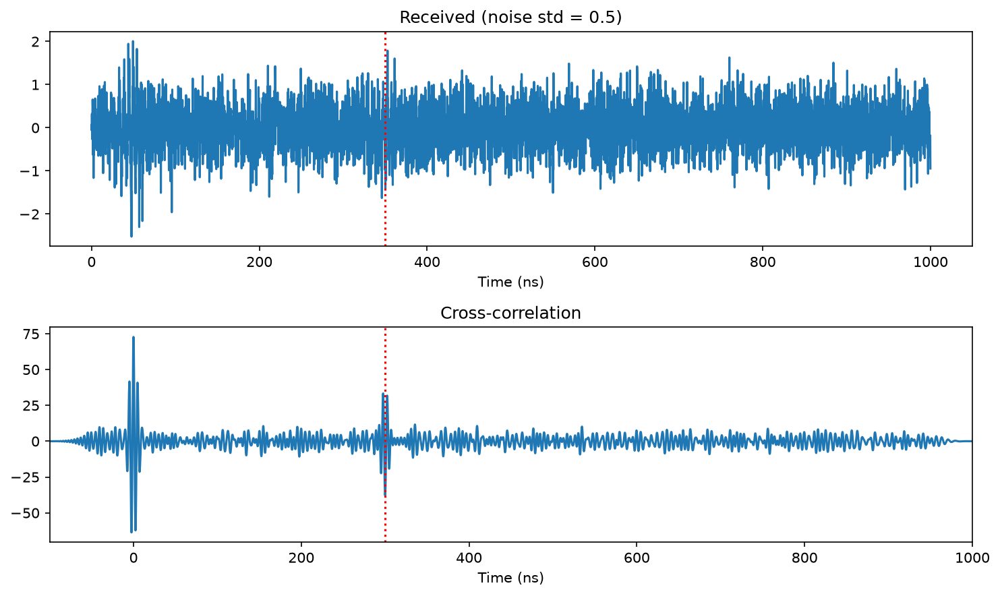
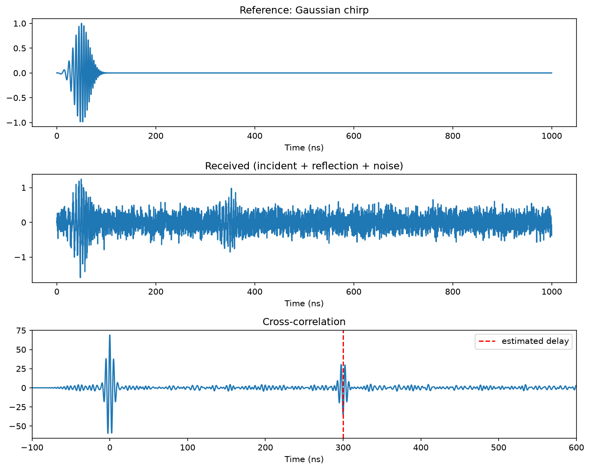
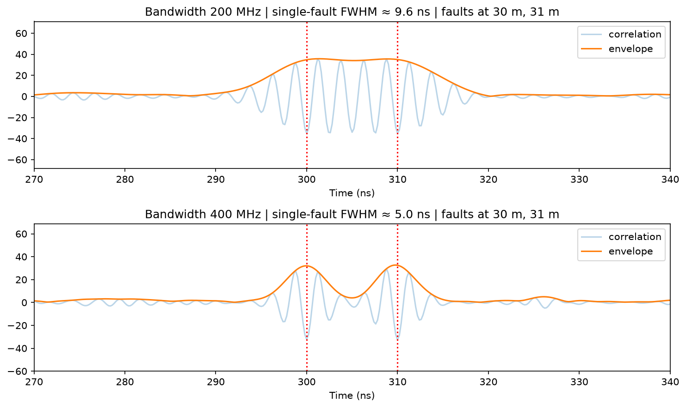
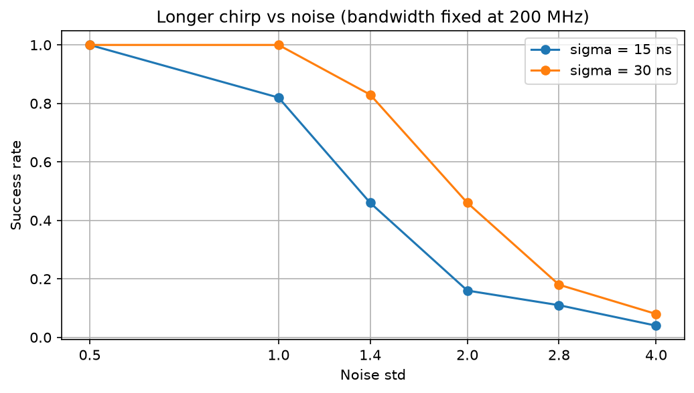

# TFDR 기반 케이블 고장 위치 추정 시뮬레이션

가우시안 처프(Gaussian chirp)를 케이블에 보내고, 돌아온 반사파를 기준 신호와 **상호상관(cross-correlation)**해서 고장 위치와 반사 계수를 추정하는 시뮬레이션입니다. 처프의 **대역폭이 거리 분해능을, 처프의 길이가 잡음을 견디는 능력을** 각각 정한다는 것을 실험으로 확인했습니다.



*잡음 표준편차가 반사파 크기와 같을 때(0.5). 받은 신호(위)에서는 반사파가 보이지 않지만, 상호상관(아래)에서는 300 ns에 뚜렷한 봉우리가 나타난다.*

---

## 배경

TFDR(Time-Frequency Domain Reflectometry)은 케이블에 처프 신호를 보내고, 고장 지점에서 돌아온 반사파를 시간-주파수 영역에서 분석해 고장을 찾는 기법입니다 [1, 2]. 이 프로젝트는 그 원리를 단계적으로 재현하는 것을 목표로 하며, 현재는 **시간 영역 상호상관** 단계까지 구현했습니다. 논문 방식인 위그너-빌 분포 기반 시간-주파수 상호상관은 다음 단계로 진행 중입니다.

신호처리 기초(FFT, 처프, 스펙트로그램, 위그너-빌 분포) 실습은 [dsp-fundamentals](https://github.com/jingyu-k/dsp-fundamentals)에 정리했습니다.

## 방법



1. **기준 신호 생성:** 가우시안 포락선을 씌운 처프 (중심 주파수 fc, 대역폭 B, 포락선 폭 σ)
2. **케이블 모델:** 받은 신호 = 보낸 처프 + Γ × (τ만큼 늦게 돌아온 처프) + 백색 가우시안 잡음
   - τ = 2d / v (d: 고장 거리, v: 케이블 속 신호 속도, 왕복이므로 2배)
   - Γ: 반사 계수 (+: 끊어짐 쪽, −: 합선 쪽)
3. **상호상관:** 받은 신호 위에서 기준 처프를 밀어 가며 유사도 계산 (정합 필터)
4. **고장 위치 추정:** 0 ns 근처(보낸 신호 자체)를 제외한 가장 큰 봉우리의 지연 시간 τ로 d = v·τ / 2 계산

### 기본 설정

| 항목 | 값 |
|---|---|
| 샘플링 주파수 | 5 GHz |
| 신호 속도 v | 2×10⁸ m/s (빛 속도의 약 2/3) |
| 처프 중심 주파수 / 대역폭 / σ | 200 MHz / 200 MHz / 15 ns |
| 고장 위치 / 반사 계수 | 30 m / −0.5 |
| 잡음 표준편차 | 0.2 (반사파 크기 0.5) |

## 결과

### 1. 고장 위치와 반사 계수 추정

- 추정 고장 위치: **30 m** (실제 30 m)
- 반사파 봉우리 ÷ 입사파 봉우리: **−0.508** (실제 Γ = −0.5)
  - 상호상관은 받은 신호와 기준 신호를 한 번 곱하므로 봉우리 크기가 Γ에 그대로 비례한다. 봉우리 비율로 고장의 종류(부호)와 심한 정도(크기)까지 추정할 수 있다.
- 상호상관 후 반사파 덩어리 폭이 약 80 ns → 약 10 ns로 좁아졌다 (펄스 압축).

### 2. 거리 분해능은 대역폭이 정한다



고장 두 개(30 m, 31 m)를 넣고 상호상관의 포락선으로 구분 여부를 확인했다. 중심 주파수는 400 MHz로 고정하고 대역폭만 바꿨다.

| 대역폭 | 압축 후 반높이 폭 | 거리 분해능 (v × 폭 / 2) | 30 m + 31 m |
|---|---|---|---|
| 200 MHz | 9.6 ns | 약 1 m | 평평한 고원 (구분 한계) |
| 400 MHz | 5.0 ns | 약 0.5 m | 두 봉우리로 확실히 구분 |

- 대역폭 2배 → 반높이 폭 절반. 압축된 폭 ≈ 1 / 대역폭.
- 30 m + 33 m는 두 경우 모두 구분, 30 m + 30.5 m는 200 MHz에서 하나로 뭉쳤다.

### 3. 잡음 견딤은 처프 길이가 정한다



잡음 크기마다 100회 시행, 추정 오차 1 m 이내를 성공으로 계산했다. 대역폭은 200 MHz로 고정하고 처프 길이(σ)만 바꿨다.

| 잡음 표준편차 | 0.5 | 1.0 | 1.4 | 2.0 | 2.8 | 4.0 |
|---|---|---|---|---|---|---|
| σ = 15 ns | 100% | 82% | 46% | 16% | 11% | 4% |
| σ = 30 ns | 100% | 100% | 83% | 46% | 18% | 8% |

- 처프 길이 2배(에너지 약 2배) → 성공률 곡선이 잡음 축 방향으로 **√2배** 이동 (σ = 30 ns의 잡음 2.0 ≈ σ = 15 ns의 잡음 1.4, 둘 다 46%).
- 상호상관은 N개 지점을 곱해서 더할 때 반사파는 N배, 잡음은 약 √N배로 커지므로 신호 대 잡음 비가 약 √N배 좋아진다 (처리 이득).

### 결론

처프는 **길이로 잡음 견딤을, 대역폭으로 거리 분해능을 따로 조절**할 수 있다. 짧은 펄스는 분해능을 위해 짧게 만들면 에너지가 줄어드는 반면, 처프는 길게 보내 에너지를 확보하면서도 압축 후에는 대역폭만큼 날카로운 봉우리를 얻는다.

## 한계

- 손실과 분산이 없는 이상적인 케이블, 백색 가우시안 잡음을 가정했다. 실제 케이블에서는 주파수마다 속도가 조금씩 달라 반사파 모양이 일그러진다.
- 보낸 신호 자체의 봉우리를 피하려고 0~100 ns를 탐색에서 제외했으므로, 약 10 m보다 가까운 고장은 찾지 못한다.
- 논문 방식인 시간-주파수 상호상관이 아니라 시간 영역 상호상관을 사용했다.
- 성공률은 100회 시행 기준이라 수 % 정도의 통계적 흔들림이 있다.

## 다음 단계

- 위그너-빌 분포 기반 시간-주파수 상호상관으로 바꿔 시간 영역 방식과 비교
- 반사파가 여러 개 섞일 때 위그너-빌 분포의 교차항이 미치는 영향 확인
- 케이블 분산(주파수에 따른 속도 차이) 모델 추가

## 구조와 실행

```
tfdr-fault-localization/
├── src/tfdr_sim.py                        # 처프 생성, 케이블 모델, 상호상관, 거리 추정
├── notebooks/
│   ├── 01_time_domain_correlation.ipynb   # 기본 고장 위치 추정
│   └── 02_resolution_and_noise.ipynb      # 분해능, 잡음 성능 분석
├── figures/
└── requirements.txt
```

```bash
python -m venv .venv
pip install -r requirements.txt
```

## 진행 방식

이 프로젝트는 AI(Claude)와 함께 개념을 학습하며 진행했습니다. 실험마다 결과를 먼저 예상하고, 실행 결과와 비교·해석한 과정을 각 노트북에 기록했습니다. 예상이 틀렸던 경우(예: 반사 봉우리 비율을 Γ²로 예상했으나 실제로는 Γ에 비례, 대역폭을 바꿔도 분해능이 그대로일 것으로 예상했으나 실제로는 2배 향상)도 그대로 남겨 두었습니다.

## 참고문헌

[1] Y.-J. Shin, E. J. Powers, T.-S. Choe, C.-Y. Hong, E.-S. Song, J.-G. Yook, and J. B. Park, "Application of time-frequency domain reflectometry for detection and localization of a fault on a coaxial cable," *IEEE Transactions on Instrumentation and Measurement*, vol. 54, no. 6, 2005. doi:10.1109/TIM.2005.858115

[2] 송은석, 신용준, 최덕선, 육종관, 박진배, E. J. Powers, "Time Frequency Domain Reflectometry 기법을 이용한 Coaxial Cable에서의 결함 감지 및 추정," *한국항행학회 논문지*, 7권 1호, 2003.

---

강진규 (Kang Jingyu) · 연세대학교 전기전자공학부 · [ORCID](https://orcid.org/0009-0009-7988-3662)
